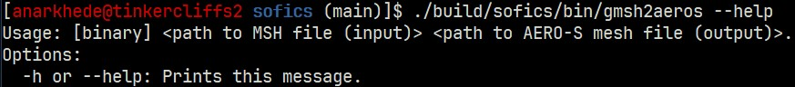
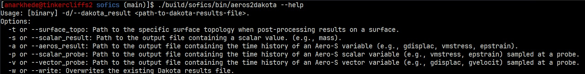
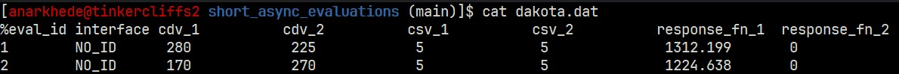

# Verifying an Installation

These checks confirm that `SOFICS` and its tools were built correctly. Commands assume the default install directory, `build/sofics/bin`.

## Tools

```sh
./build/sofics/bin/gmsh2aeros --help
```

The output from a successful build should look like,


```sh
./build/sofics/bin/aeros2dakota --help
```

The output from a successful build should look like,


## End-to-end check

The `examples/explosion_containment/short_async_evaluations` case exercises the whole workflow: `Gmsh` meshing, `gmsh2aeros`, the coupled `M2C`/`Aero-S` simulation, and post-processing through `aeros2dakota`. It should take a couple of minutes to run on four cores.

```sh
cd examples/explosion_containment/short_async_evaluations
dakota -i dakota.in -o dakota.log -w dakota.rst
cat dakota.dat
```


